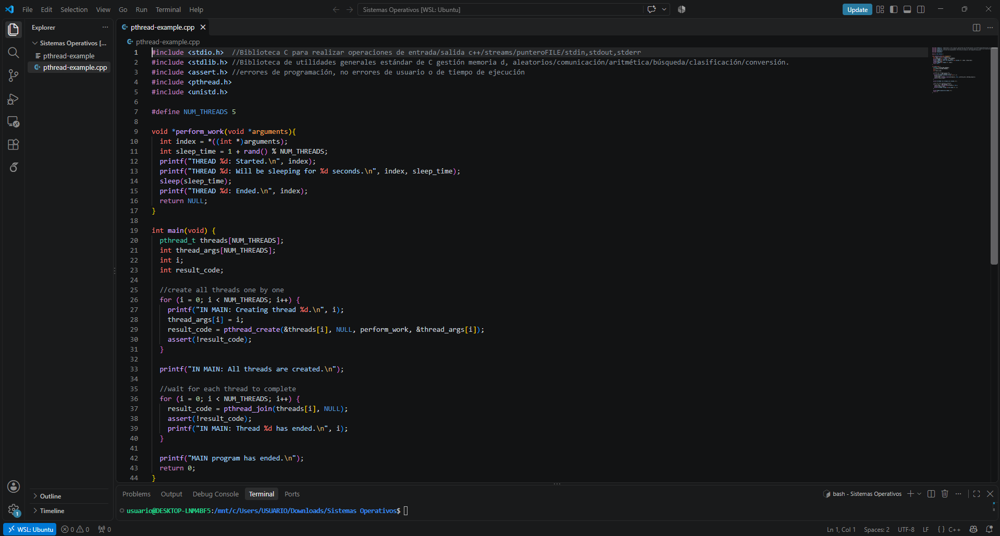

# Trabajo-Sistemas-Operativos
## Threads (Hilos)

### 1. Introducción

Los hilos (Threads) son unidades de ejecución que permiten que un proceso realice varias tareas de manera concurrente. Comparten los recursos del mismo proceso, pero cada hilo puede ejecutar sus propias instrucciones de forma independiente.

En los sistemas operativos, los hilos permiten aprovechar mejor el procesador y realizar varias actividades sin necesidad de crear procesos independientes.

### 2. Descripción del código original

El programa proporcionado utiliza la biblioteca `pthread.h` para crear y administrar hilos en C++.

Su funcionamiento consiste en crear cinco hilos. Cada uno recibe un identificador y calcula un tiempo de espera aleatorio entre uno y cinco segundos. Después, muestra un mensaje indicando cuándo comienza, cuánto tiempo esperará y cuándo termina.

La función `pthread_create()` permite crear los hilos, mientras que `pthread_join()` hace que el programa principal espere a que cada uno finalice antes de terminar la ejecución.

### 3. Análisis crítico del código original

Al analizar el programa, se identificaron algunos aspectos que podían mejorarse:

- No se inicializa el generador de números aleatorios, por lo que la secuencia puede repetirse entre ejecuciones.
- Se utiliza `assert()` para comprobar errores, pero no proporciona mensajes descriptivos ni permite gestionar adecuadamente los fallos.
- Los datos de cada hilo se pasan mediante un arreglo de enteros, lo que limita la información que puede recibir cada uno.
- No existe una gestión específica cuando falla la creación de un hilo.

### 4. Mejoras implementadas

Se realizaron modificaciones para mejorar la organización y el control del programa:

- Se agregó `srand()` junto con `time(NULL)` para inicializar el generador de números aleatorios.
- Se implementó una estructura llamada `ThreadData` para almacenar el identificador y el tiempo de espera de cada hilo.
- Se reemplazó el uso de `assert()` por condiciones que comprueban los errores y muestran mensajes descriptivos.
- Se agregó un contador para registrar cuántos hilos se crearon correctamente y esperar únicamente a esos hilos mediante `pthread_join()`.

### 5. Comparación entre ambas versiones

El programa original cumple con la función de crear cinco hilos y esperar a que finalicen. Sin embargo, su gestión de errores es limitada y la información de cada hilo se transmite de una manera sencilla.

La versión mejorada conserva el funcionamiento principal, pero incorpora una mejor organización de los datos, inicialización de los números aleatorios y comprobación de errores. Esto permite que el programa sea más claro y tenga un mejor control durante su ejecución.

### 6. Evidencias

**Código original**

**Resultado de la ejecución original**

**Código mejorado**

**Resultado de la ejecución mejorada**

### 7. Conclusión

El desarrollo de esta actividad permitió comprender cómo funcionan los hilos y cómo pueden ejecutarse varias tareas de manera concurrente dentro de un mismo proceso. También permitió conocer la importancia de utilizar correctamente funciones como `pthread_create()` y `pthread_join()`, así como implementar mecanismos para controlar errores y organizar mejor la información compartida con cada hilo.
